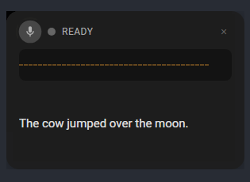

# Yammer

Local speech-to-text with LLM correction. Speak naturally, get polished text typed into any application.



## Features

- **Streaming Speech-to-Text** - Kyutai STT model transcribes as you speak
- **LLM Text Correction** - Fixes homophones, adds punctuation, removes filler words
- **Floating Overlay** - Transparent window with real-time waveform visualization
- **Universal Input** - Types into any application (xdotool on Linux, enigo on macOS/Windows)
- **100% Local** - No cloud services, all processing on-device
- **GPU Accelerated** - Optional CUDA support for faster transcription on Linux/Windows
- **Cross-Platform** - Linux, macOS, and Windows

## Requirements

- 4GB RAM minimum, 8GB recommended
- ~2GB disk for models

### Linux

X11 session required (Wayland not yet supported).

```bash
echo $XDG_SESSION_TYPE  # Should output: x11
```

### macOS

**Accessibility permission is required** for the global hotkey to work outside the app. On first launch, grant access when prompted, or manually:

1. Open **System Settings > Privacy & Security > Accessibility**
2. Click "+" and add Yammer.app
3. Ensure the toggle is enabled

If the hotkey stops working after an update, remove and re-add Yammer in the Accessibility list (the binary signature changes on rebuild).

### Windows

No special permissions needed.

## Quick Start

### 1. Install Dependencies

```bash
# Ubuntu/Debian
sudo apt install clang libclang-dev libasound2-dev cmake xdotool \
  libayatana-appindicator3-dev libwebkit2gtk-4.1-dev nodejs npm

# Arch Linux
sudo pacman -S clang alsa-lib cmake xdotool libayatana-appindicator nodejs npm

# Fedora
sudo dnf install clang clang-devel alsa-lib-devel cmake xdotool \
  libayatana-appindicator-gtk3-devel webkit2gtk4.1-devel nodejs npm

# macOS
brew install cmake node

# Windows
choco install llvm nodejs
```

### 2. Build

```bash
git clone https://github.com/andynu/yammer.git
cd yammer
cargo build --release

# With CUDA support (Linux/Windows with NVIDIA GPU)
cargo build --release --features cuda
```

### 3. Run

```bash
# GUI mode
cd yammer-app && npm install && npm run tauri dev

# CLI mode (for testing)
cargo run --release --bin yammer dictate
```

STT models are downloaded automatically from HuggingFace on first run (~2GB).

## Usage

### GUI Mode

The floating overlay shows:
- Microphone status and state indicator
- Real-time waveform visualization
- Transcribed and corrected text

**Default hotkey:**
- **Linux/Windows**: Hold Ctrl+Super to dictate, release to stop
- **macOS**: Hold right Command to dictate, release to stop

Text is automatically typed into the focused application.

### CLI Commands

```bash
yammer dictate          # Live dictation
yammer list-devices     # List audio devices
yammer record -d 5 -o test.wav  # Record audio
yammer transcribe test.wav      # Transcribe a file
yammer vad-test -d 30   # Test voice activity detection
yammer correct "text"   # Correct text with LLM
```

## Project Structure

```
yammer/
├── yammer-core/     # Shared types, config, model management
├── yammer-audio/    # Audio capture, VAD, resampling
├── yammer-stt/      # Kyutai streaming speech-to-text
├── yammer-llm/      # LLM text correction
├── yammer-output/   # Text output (xdotool/enigo/clipboard)
├── yammer-cli/      # CLI interface
└── yammer-app/      # Tauri desktop app
```

## Architecture

```
Microphone → Audio Capture → VAD → Resampler (24kHz)
                                       ↓
                              Kyutai STT (streaming) → LLM Correction → Type/Paste → Active Window
                                       ↓
                               Tauri UI (waveform, status, text)
```

## Configuration

Config file: `~/.config/yammer/config.toml` (Linux), `~/Library/Application Support/yammer/config.toml` (macOS)

```toml
[hotkey]
hold_keys = ["RightSuper"]  # macOS: right Command key
# hold_keys = ["Control", "Super"]  # Linux/Windows default
toggle_key = "F6"  # Optional toggle mode key

[audio]
vad_threshold = 0.01  # Lower = more sensitive
silence_timeout_seconds = 5

[output]
method = "type"  # "type" or "clipboard"
```

## Troubleshooting

**macOS: Hotkey doesn't work outside the app**
Grant Accessibility permission (see Requirements above). After rebuilding, you may need to remove and re-add the app.

**Build fails with "stdbool.h not found"**
```bash
sudo apt install clang libclang-dev
```

**"No audio devices found"**
```bash
# Linux
sudo apt install libasound2-dev
cargo clean && cargo build --release
```

**Transcription slow**
Use `--release` builds. On Linux/Windows with NVIDIA GPU, build with `--features cuda`.

## Documentation

- [Audio Testing Guide](./AUDIO_TESTING.md)
- [UI Testing Guide](./yammer-app/TESTING.md)
- [Architecture & Onboarding](./docs/ONBOARDING.md)

## License

MIT - See [LICENSE](./LICENSE) and [THIRD_PARTY_NOTICES.md](./THIRD_PARTY_NOTICES.md) for details.

## Credits

- [Kyutai Moshi](https://github.com/kyutai-labs/moshi) - Streaming speech-to-text
- [Tauri](https://tauri.app/) - Desktop app framework
- [cpal](https://github.com/RustAudio/cpal) - Cross-platform audio I/O
- [candle](https://github.com/huggingface/candle) - ML inference
