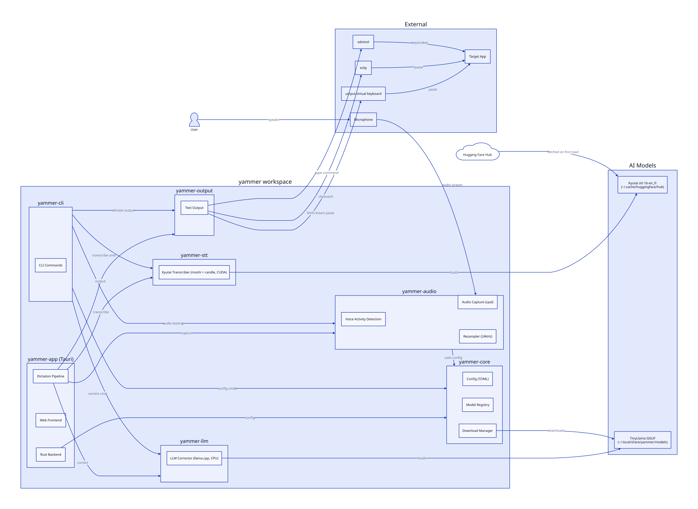
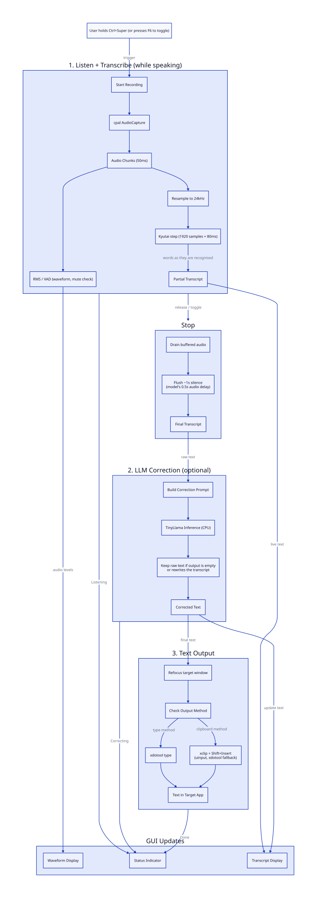

# Yammer Architecture

Yammer is a **local, on-device dictation application for Linux**. Hold a hotkey and speak; words appear as you talk, an optional LLM pass fixes punctuation and homophones, and the result is typed into whatever application has focus. Nothing leaves the machine.

This page covers how the code is put together. For requirements, building, running, CLI commands, configuration and troubleshooting, see the [README](../README.md).

---

## Crates

Yammer is a **Rust workspace** with 7 crates:

| Crate | Purpose | Key Dependencies |
|-------|---------|------------------|
| `yammer-core` | Configuration, model registry, downloads | tokio, reqwest, serde |
| `yammer-audio` | Microphone capture, VAD, resampling | cpal, rubato |
| `yammer-stt` | Kyutai streaming speech-to-text | moshi, candle (CUDA) |
| `yammer-llm` | LLM text correction | llama_cpp (CPU) |
| `yammer-output` | Text injection via xdotool, clipboard, uinput | evdev |
| `yammer-cli` | Command-line interface for testing | clap |
| `yammer-app` | Tauri GUI with waveform visualization | tauri v2, rdev |

---

## Component Diagram



Source: [`components.d2`](components.d2). Regenerate with `d2 components.d2 components.svg`.

---

## Call Flow Diagram



Source: [`callflow.d2`](callflow.d2). Regenerate with `d2 callflow.d2 callflow.svg`.

---

## Data Flow Summary

```
User holds the hotkey and speaks
        │
        ▼
┌─────────────────────────────────────────────┐
│  PHASE 1: Listen + Transcribe               │
│  (yammer-audio, yammer-stt)                 │
│  • cpal captures 50 ms chunks               │
│  • RMS/VAD drive the waveform and detect a  │
│    muted mic                                │
│  • Resample to 24 kHz mono                  │
│  • Kyutai consumes 80 ms steps and emits    │
│    words while the user is still talking    │
└─────────────────────────────────────────────┘
        │ hotkey released: drain audio, flush
        │ ~1 s of silence for the model's 0.5 s
        │ audio delay
        ▼ "im going to the store"
┌─────────────────────────────────────────────┐
│  PHASE 2: Correction (yammer-llm, optional) │
│  • TinyLlama with a few-shot prompt, on CPU │
│  • Raw text kept if the output is empty or  │
│    rewrites the transcript                  │
└─────────────────────────────────────────────┘
        │ "I'm going to the store."
        ▼
┌─────────────────────────────────────────────┐
│  PHASE 3: Output (yammer-output)            │
│  • Refocus the window that had focus at     │
│    activation                               │
│  • xdotool type, or xclip + Shift+Insert    │
│    through a uinput virtual keyboard        │
└─────────────────────────────────────────────┘
        │
        ▼
Text appears in focused application
```

The app logs a per-dictation stage timing line at `info` level (`Dictation timing (...)`), which is the place to look for where time goes.

---

## Key Files to Understand

### Start Here (in order)

| File | What You'll Learn |
|------|-------------------|
| `yammer-core/src/config.rs` | Configuration system, all settings and defaults |
| `yammer-core/src/model.rs` | Downloadable models (the LLM; the STT model comes from Hugging Face) |
| `yammer-audio/src/capture.rs` | How audio is captured with cpal |
| `yammer-audio/src/vad.rs` | Voice activity detection |
| `yammer-stt/src/transcriber.rs` | Kyutai model loading, streaming steps, batch transcription |
| `yammer-llm/src/corrector.rs` | LLM text correction and its fallbacks |
| `yammer-output/src/lib.rs` | Text output via xdotool and the clipboard |
| `yammer-app/src-tauri/src/lib.rs` | Hotkey listener, Tauri commands, app state |
| `yammer-app/src-tauri/src/pipeline.rs` | Full dictation pipeline orchestration |

---

## Architecture Decisions

1. **Local-only processing.** Privacy by design, no cloud APIs. Model weights are downloaded once, then everything runs on-device.
2. **Streaming STT on GPU, LLM on CPU.** Kyutai runs through candle on CUDA and streams words during speech; CPU inference is too slow for live audio. `llama_cpp` is built without CUDA and TinyLlama is small enough for the CPU. candle carries no ggml, so it does not clash with llama.cpp's.
3. **Energy-based VAD.** A simple RMS threshold, no ML model. In the app it drives the waveform and timing; the STT model decides what is speech. `yammer dictate` in the CLI uses it to split speech into segments.
4. **Modular crates.** Each stage is independently testable.
5. **Tauri v2.** Modern desktop app with a small binary.

Model choices, including the ones rejected and why, are recorded in [decisions/models.md](decisions/models.md) and [ADR-001](decisions/001-voxtral-realtime-evaluation.md). GNOME-specific setup is in [GNOME_SETUP.md](GNOME_SETUP.md).
